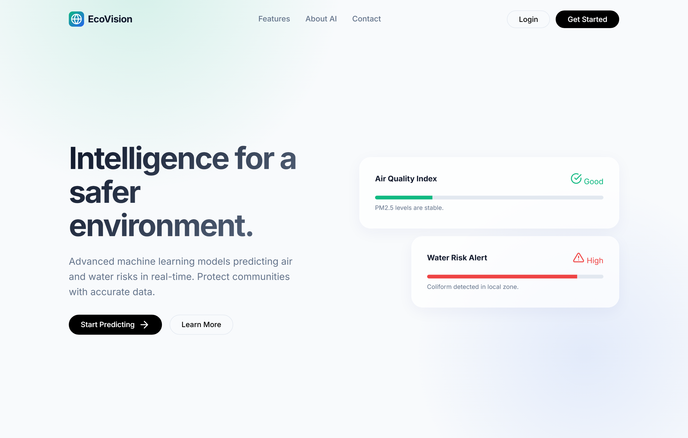
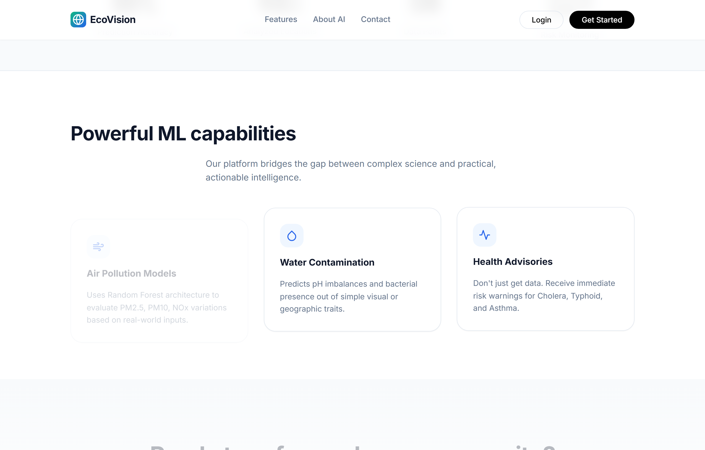
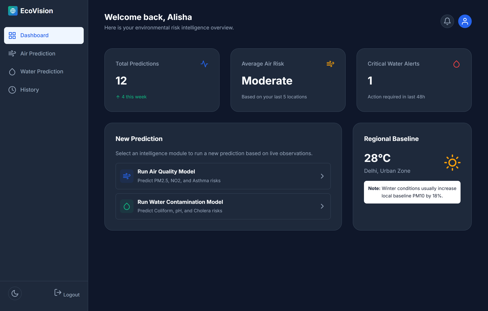
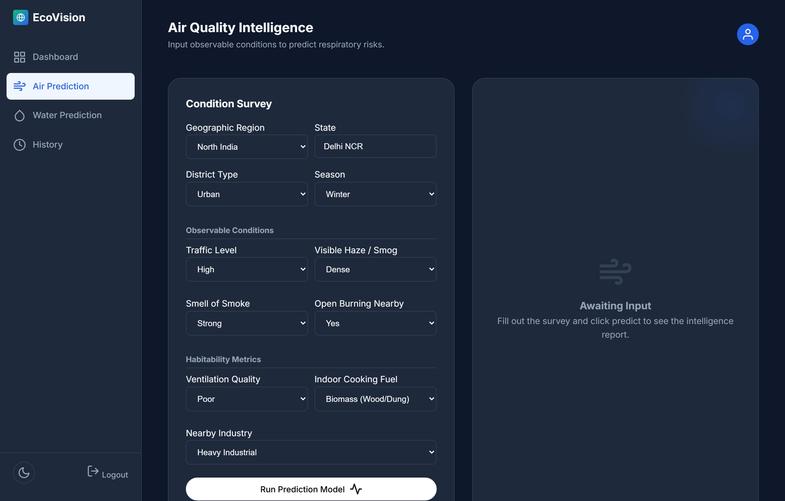
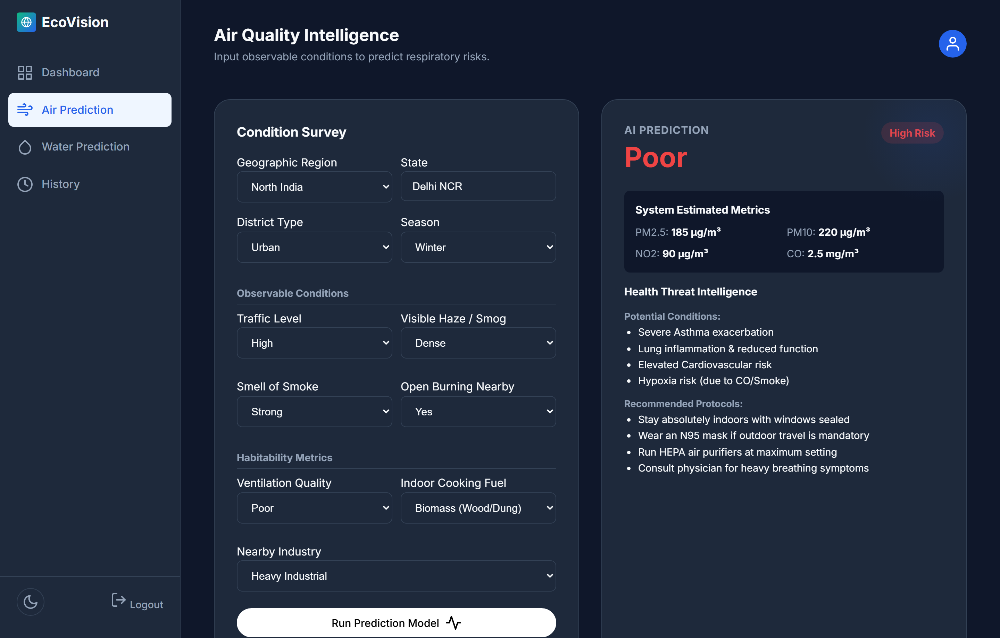
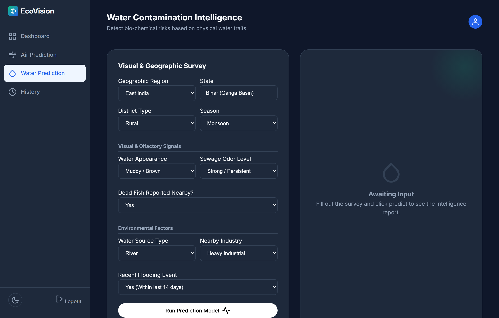
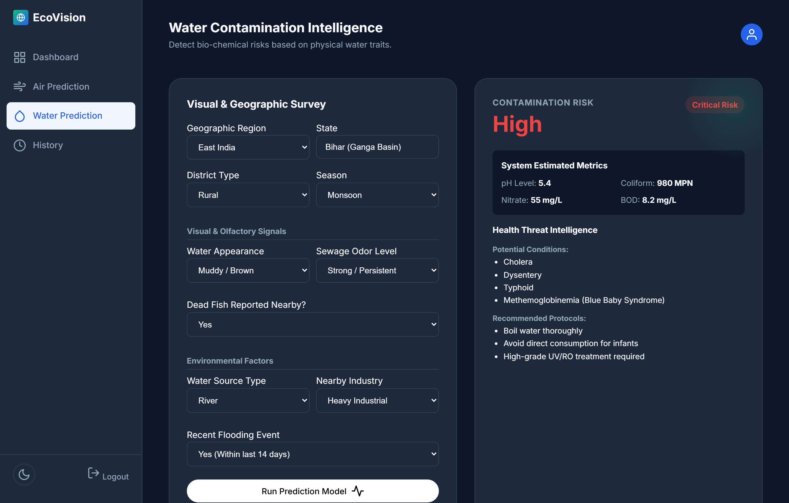
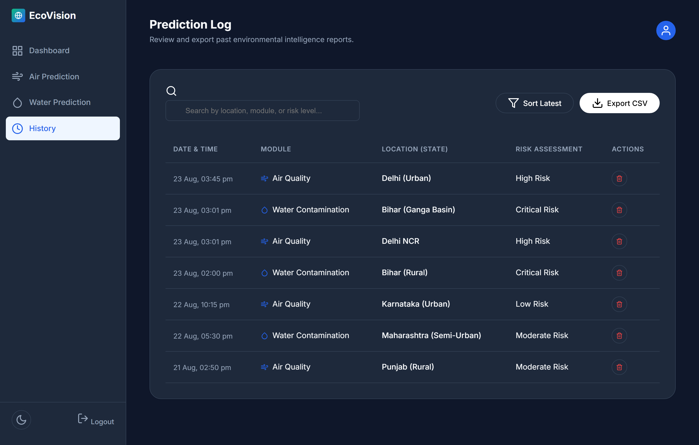
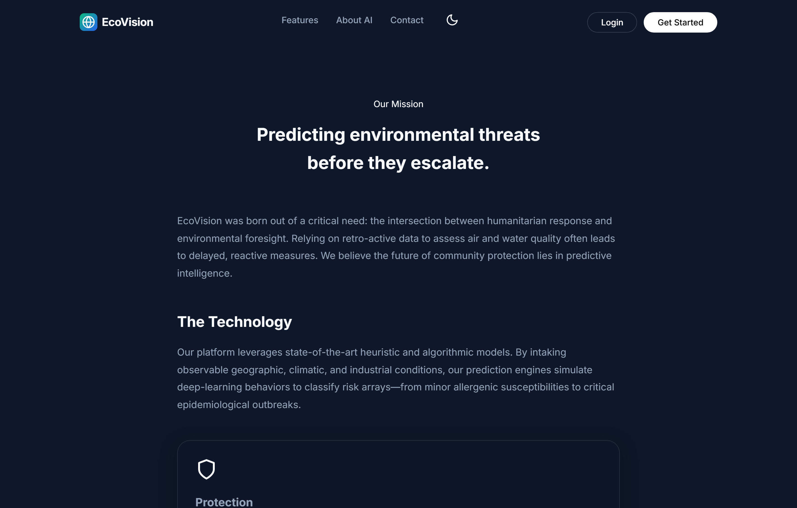
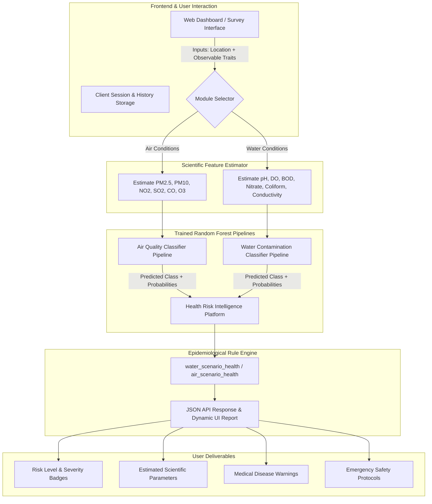

# 🌍 EcoVision: Humanitarian Risk Intelligence Platform

[](https://www.python.org/)
[](https://scikit-learn.org/)
[](https://flask.palletsprojects.com/)
[](#frontend-architecture)
[](#)
[](LICENSE)

> **Predictive Environmental Intelligence & Epidemiological Threat Forecasting**  
> Bridging the gap between scientific laboratory metrics and real-world humanitarian response by translating everyday observable conditions into accurate air and water contamination risk assessments, actionable public health advisories, and life-saving mitigation protocols.

---

## 📑 Table of Contents

- [Overview](#-overview)
- [Key Platform Features](#-key-platform-features)
- [Visual Walkthrough & Interface Screenshots](#-visual-walkthrough--interface-screenshots)
  - [1. Landing Page & Value Proposition](#1-landing-page--value-proposition)
  - [2. Interactive Analytics Dashboard](#2-interactive-analytics-dashboard)
  - [3. Air Quality Intelligence Module](#3-air-quality-intelligence-module)
  - [4. Water Contamination Intelligence Module](#4-water-contamination-intelligence-module)
  - [5. Historical Prediction Logs & Data Export](#5-historical-prediction-logs--data-export)
  - [6. Platform Mission & Architecture](#6-platform-mission--architecture)
- [System Architecture & Data Flow](#-system-architecture--data-flow)
- [Machine Learning & Scientific Modeling](#-machine-learning--scientific-modeling)
  - [Air Quality Risk Pipeline](#air-quality-risk-pipeline)
  - [Water Contamination Risk Pipeline](#water-contamination-risk-pipeline)
  - [Observable-to-Scientific Feature Estimation](#observable-to-scientific-feature-estimation)
  - [Epidemiological Advisory Rule Engine](#epidemiological-advisory-rule-engine)
- [Project Directory Structure](#-project-directory-structure)
- [Installation & Quick Start](#-installation--quick-start)
- [Model Training & Dataset Generation](#-model-training--dataset-generation)
- [Scenario Stress-Testing & Validation](#-scenario-stress-testing--validation)
- [REST API Reference](#-rest-api-reference)
- [Technology Stack](#-technology-stack)
- [Roadmap & Humanitarian Impact](#-roadmap--humanitarian-impact)

---

## 🌟 Overview

In vulnerable and crisis-affected regions, field workers, local authorities, and citizens often lack access to real-time laboratory sensors for air and water monitoring. Relying on delayed post-contamination analyses leads to reactive healthcare responses and preventable disease outbreaks.

**EcoVision** solves this challenge through a dual-stage predictive pipeline:
1. **Intuitive Observable Condition Mapping**: Converts observable physical, meteorological, and environmental indicators (e.g., water turbidity, sewage odor, smoke intensity, biomass fuel use, flooding events) into estimated scientific metrics ($\text{PM}_{2.5}$, $\text{PM}_{10}$, $\text{NO}_2$, $\text{CO}$, $\text{pH}$, Coliform count, $\text{BOD}$, $\text{Nitrate}$).
2. **Machine Learning Risk Classification & Threat Intelligence**: Uses trained Random Forest models to classify environmental risk levels (`Good` / `Moderate` / `Poor` or `Low` / `Medium` / `High`) and triggers rule-based epidemiological advisories for diseases such as **Cholera, Typhoid, Dysentery, Methemoglobinemia (Blue Baby Syndrome), Severe Asthma, and Hypoxia**, complete with immediate preventive protocols.

---

## ⚡ Key Platform Features

- 💨 **Air Pollution Intelligence Engine**: Evaluates particulate matter ($\text{PM}_{2.5}$, $\text{PM}_{10}$) and toxic gas concentrations ($\text{NO}_2$, $\text{SO}_2$, $\text{CO}$, $\text{O}_3$) based on traffic, haze density, open burning, and cooking fuel.
- 💧 **Water Contamination Intelligence Engine**: Assesses chemical degradation ($\text{pH}$, $\text{BOD}$, Dissolved Oxygen, Conductivity) and biological pathogen hazards (Coliform bacteria, Nitrates) from water appearance, sewage odors, and industrial proximity.
- 🏥 **Automated Epidemiological Advisories**: Instant medical threat detection highlighting vulnerable populations (infants, elderly, respiratory patients) and actionable prevention protocols (N95 masks, HEPA filtration, UV/RO purification, boiling).
- 📊 **Real-Time Analytics & Dashboard**: Centralized hub presenting recent risk assessments, regional baseline anomalies, and direct navigation.
- 📜 **Historical Prediction Tracking & CSV Export**: Client-side encrypted history logging with instant multi-field search, date sorting, and CSV data export capabilities.
- 🛡️ **Balanced Model Reliability**: Hardened against class collapse with stratified dataset generation, class weighting, and multi-scenario permutation validation across 5,000+ edge cases.
- 🔌 **Extensible Dual Architecture**: Seamless dual deployment mode via standalone interactive client-side web platform or production-ready Flask REST APIs.

---

## 📸 Visual Walkthrough & Interface Screenshots

### 1. Landing Page & Value Proposition
The modern, responsive landing page introduces EcoVision's humanitarian mission, displaying real-time glass-morphic risk alert previews, live platform statistics, and machine learning capabilities.



#### Platform Features & Capabilities Breakdown
Detailed feature cards explain how the platform bridges the gap between complex science and practical community protection.



---

### 2. Interactive Analytics Dashboard
The user dashboard provides an environmental risk overview with active prediction counters, average risk levels, critical alert summaries, regional baseline notes, and quick action model launchers.



---

### 3. Air Quality Intelligence Module

#### Condition Survey Form
Users specify geographic region, state, district type, season, observable traffic, haze/smog density, smoke odor, open burning, habitability ventilation, cooking fuel, and industrial proximity.



#### AI Prediction & Health Advisory Output
Upon running the model, the system classifies the air quality status (`Poor` / `High Risk`), calculates estimated scientific metrics ($\text{PM}_{2.5}: 185\,\mu\text{g/m}^3$, $\text{PM}_{10}: 220\,\mu\text{g/m}^3$, $\text{NO}_2: 90\,\mu\text{g/m}^3$, $\text{CO}: 2.5\,\text{mg/m}^3$), identifies potential medical conditions (**Severe Asthma, Lung Inflammation, Cardiovascular Risk, Hypoxia**), and provides immediate mitigation protocols.



---

### 4. Water Contamination Intelligence Module

#### Visual & Geographic Survey Form
Captures observable physical attributes such as water turbidity, sewage odor severity, dead fish sightings, water source type (municipal, borewell, river, lake), industrial activity, and recent flood events.



#### Bio-Chemical Risk Assessment & Epidemiological Alert
The model outputs a `High` / `Critical Risk` classification alongside estimated laboratory values ($\text{pH}: 5.4$, $\text{Coliform}: 980\,\text{MPN}$, $\text{Nitrate}: 55\,\text{mg/L}$, $\text{BOD}: 8.2\,\text{mg/L}$) and immediate warnings for water-borne pathogens (**Cholera, Typhoid, Dysentery, Blue Baby Syndrome**) with sterilization guidelines.



---

### 5. Historical Prediction Logs & Data Export
The interactive prediction log maintains a searchable, chronological audit trail of all air and water assessments. Users can filter by location, module, or risk level, sort by date, and export full reports to CSV.



---

### 6. Platform Mission & Architecture
The about page documents the foundational humanitarian goals, heuristic algorithms, and technological safeguards underpinning the platform.



---

## 🏗️ System Architecture & Data Flow



---

## 🔬 Machine Learning & Scientific Modeling

### Air Quality Risk Pipeline
- **Dataset**: `india_air_quality_full.xlsx` / `india_air_quality_full.csv`
- **Features**: 
  - *Numerical*: $\text{PM}_{2.5}$, $\text{PM}_{10}$, $\text{NO}_2$, $\text{SO}_2$, $\text{CO}$, $\text{O}_3$
  - *Categorical*: $\text{Region}$, $\text{State}$, $\text{District\_Type}$
- **Target**: `Air_Quality` (`Good`, `Moderate`, `Poor`)
- **Pipeline Architecture**: `ColumnTransformer` with `OneHotEncoder(handle_unknown='ignore')` + `RandomForestClassifier(n_estimators=300, max_depth=15, min_samples_split=5, class_weight='balanced')`
- **Artifacts**: `air_model.pkl`, `air_feature_columns.pkl`

### Water Contamination Risk Pipeline
- **Dataset**: `india_water_quality_full.xlsx` / `india_water_quality_full.csv`
- **Features**: 
  - *Numerical*: $\text{pH}$, $\text{DO}$ (Dissolved Oxygen), $\text{BOD}$ (Biochemical Oxygen Demand), $\text{Nitrate}$, $\text{Coliform}$, $\text{Conductivity}$
  - *Categorical*: $\text{Region}$, $\text{State}$, $\text{District\_Type}$
- **Target**: `Risk` (`Low`, `Medium`, `High`)
- **Pipeline Architecture**: `ColumnTransformer` with `OneHotEncoder(handle_unknown='ignore')` + `RandomForestClassifier(n_estimators=300, max_depth=15, min_samples_split=5, class_weight='balanced')`
- **Artifacts**: `water_model.pkl`, `feature_columns.pkl`

### Observable-to-Scientific Feature Estimation

The platform establishes mathematical heuristics mapping physical survey variables into bounded scientific domains:

| Module | Observable Input | Impact on Scientific Parameter |
| :--- | :--- | :--- |
| **Water** | `water_appearance = "muddy"` | $\text{Coliform} \uparrow +220\,\text{MPN},\;\text{BOD} \uparrow +1.5\,\text{mg/L},\;\text{DO} \downarrow -0.8\,\text{mg/L}$ |
| **Water** | `sewage_smell = "strong"` | $\text{Coliform} \uparrow +260\,\text{MPN},\;\text{BOD} \uparrow +2.0\,\text{mg/L},\;\text{DO} \downarrow -0.8\,\text{mg/L}$ |
| **Water** | `dead_fish_reported = "yes"` | $\text{DO} \downarrow -1.6\,\text{mg/L},\;\text{BOD} \uparrow +2.2\,\text{mg/L},\;\text{Coliform} \uparrow +140\,\text{MPN}$ |
| **Water** | `recent_flood = "yes"` | $\text{Coliform} \uparrow +260\,\text{MPN},\;\text{Nitrate} \uparrow +10\,\text{mg/L},\;\text{DO} \downarrow -0.7\,\text{mg/L}$ |
| **Air** | `traffic_level = "high"` | $\text{PM}_{2.5} \uparrow +22\,\mu\text{g/m}^3,\;\text{PM}_{10} \uparrow +40\,\mu\text{g/m}^3,\;\text{NO}_2 \uparrow +18\,\mu\text{g/m}^3,\;\text{CO} \uparrow +0.5\,\text{mg/m}^3$ |
| **Air** | `visible_haze = "dense"` | $\text{PM}_{2.5} \uparrow +45\,\mu\text{g/m}^3,\;\text{PM}_{10} \uparrow +70\,\mu\text{g/m}^3$ |
| **Air** | `smell_of_smoke = "strong"` | $\text{PM}_{2.5} \uparrow +28\,\mu\text{g/m}^3,\;\text{CO} \uparrow +0.7\,\text{mg/m}^3,\;\text{SO}_2 \uparrow +6\,\mu\text{g/m}^3$ |
| **Air** | `indoor_cooking_fuel = "biomass"` | $\text{PM}_{2.5} \uparrow +28\,\mu\text{g/m}^3,\;\text{CO} \uparrow +0.8\,\text{mg/m}^3,\;\text{NO}_2 \uparrow +8\,\mu\text{g/m}^3$ |

### Epidemiological Advisory Rule Engine

| Environmental Threshold | Primary Disease Vulnerabilities | Emergency Recommended Protocol |
| :--- | :--- | :--- |
| $\text{Coliform} > 500\,\text{MPN}$ | Cholera, Typhoid, Dysentery | Boil water vigorously; direct UV/RO filtration required |
| $\text{Nitrate} > 50\,\text{mg/L}$ | Methemoglobinemia (Blue Baby Syndrome) | Strictly avoid direct infant consumption; use certified water source |
| $\text{BOD} > 6.0\,\text{mg/L}$ | Gastrointestinal infections | Employ multi-stage sediment and carbon filtration |
| $\text{pH} < 5.5 \text{ or } > 9.0$ | Severe skin and ocular irritation | Avoid bathing or skin contact; neutralize water supply |
| $\text{PM}_{2.5} > 120\,\mu\text{g/m}^3$ | Severe Asthma exacerbation, Lung inflammation | Stay indoors with sealed windows; wear N95 mask; run HEPA air purifiers |
| $\text{NO}_2 > 80\,\mu\text{g/m}^3$ | Acute respiratory irritation | Avoid major traffic corridors; maintain filtered indoor airflow |
| $\text{CO} > 2.0\,\text{mg/m}^3$ | Hypoxia risk, Carbon monoxide toxicity | Ensure immediate mechanical cross-ventilation |

---

## 📁 Project Directory Structure

```text
HumantarianRiskIntelligence/
├── 📄 README.md                             # Comprehensive project documentation
├── 📄 requirements.txt                       # Project dependencies
├── 📄 health_risk_intelligence_platform.py  # Unified dual-module health platform engine
├── 📄 app_air_predictor.py                  # Air quality feature estimator & prediction logic
├── 📄 app_risk_predictor.py                 # Water risk feature estimator & prediction logic
├── 📄 flask_air_api.py                      # Flask REST API server for Air Quality (Port 5001)
├── 📄 flask_water_api.py                    # Flask REST API server for Water Quality (Port 5000)
├── 📄 train_air_quality_pipeline.py         # Model training script for Air Quality
├── 📄 train_water_risk_pipeline.py          # Model training script for Water Risk
├── 📄 generate_india_air_dataset.py         # Synthetic air dataset generator
├── 📄 generate_india_water_dataset.py       # Synthetic water dataset generator
├── 📄 validate_air_prediction_balance.py    # Multi-scenario balance verification for Air
├── 📄 validate_app_prediction_balance.py    # Multi-scenario balance verification for Water
├── 📄 capture_screenshots.py                # Automated headless Chrome CDP screenshot generator
│
├── 🧠 Pre-Trained Model Artifacts
│   ├── air_model.pkl                        # Serialized Air RandomForest Pipeline
│   ├── air_feature_columns.pkl              # Air feature schema
│   ├── water_model.pkl                      # Serialized Water RandomForest Pipeline
│   └── feature_columns.pkl                  # Water feature schema
│
├── 📊 Datasets
│   ├── india_air_quality_full.csv           # Air quality training dataset (CSV)
│   ├── india_air_quality_full.xlsx          # Air quality training dataset (Excel)
│   ├── india_water_quality_full.csv         # Water quality training dataset (CSV)
│   └── india_water_quality_full.xlsx        # Water quality training dataset (Excel)
│
├── 🌐 Web Application (Frontend)
│   ├── templates/                           # HTML5 Views
│   │   ├── index.html                       # Landing page with hero, stats & features
│   │   ├── dashboard.html                   # Main metrics dashboard
│   │   ├── air_prediction.html              # Air Quality survey & prediction interface
│   │   ├── water_prediction.html            # Water Risk survey & prediction interface
│   │   ├── history.html                     # Assessment history logs & CSV export
│   │   ├── profile.html                     # User profile settings
│   │   ├── about.html                       # AI architecture & humanitarian mission
│   │   ├── contact.html                     # Support & inquiry form
│   │   ├── login.html                       # User authentication login
│   │   └── signup.html                      # New user registration
│   │
│   └── static/                              # Static Assets
│       ├── css/                             # Modular Stylesheets
│       │   ├── variables.css                # Color tokens & typography definitions
│       │   ├── components.css               # Buttons, cards, form controls & badges
│       │   ├── animations.css               # CSS keyframes & entry transitions
│       │   ├── navbar.css                   # Header & navigation bar styling
│       │   ├── dashboard.css                # Sidebar layout & metric grid styles
│       │   ├── air.css                      # Air prediction UI theme
│       │   ├── water.css                    # Water prediction UI theme
│       │   ├── history.css                  # History table & filter toolbar styles
│       │   └── main.css                     # Global base styling
│       │
│       └── js/                              # Modular Frontend Logic
│           ├── auth.js                      # LocalStorage session & route guard
│           ├── dashboard.js                 # Dashboard view initializer
│           ├── airPrediction.js             # Air prediction form handler & mock engine
│           ├── waterPrediction.js           # Water prediction form handler & mock engine
│           ├── history.js                   # History table renderer, search & CSV export
│           ├── darkmode.js                  # Theme switching controller
│           ├── navbar.js                    # Mobile navigation toggle
│           └── profile.js                   # Profile data manager
│
└── 📸 docs/screenshots/                    # High-Resolution UI Walkthrough Screenshots
    ├── 01_landing_hero.png
    ├── 02_features_section.png
    ├── 03_dashboard_overview.png
    ├── 04_air_prediction_survey.png
    ├── 05_air_prediction_result.png
    ├── 06_water_prediction_survey.png
    ├── 07_water_prediction_result.png
    ├── 08_prediction_history.png
    └── 09_about_architecture.png
```

---

## 🚀 Installation & Quick Start

### 1. Prerequisites
- **Python 3.10+**
- **pip** package manager
- Modern Web Browser (Google Chrome, Microsoft Edge, Firefox, Safari)

### 2. Clone the Repository
```bash
git clone https://github.com/your-username/HumantarianRiskIntelligence.git
cd HumantarianRiskIntelligence
```

### 3. Create and Activate Virtual Environment
```bash
# Windows
python -m venv venv
venv\Scripts\activate

# macOS / Linux
python3 -m venv venv
source venv/bin/activate
```

### 4. Install Dependencies
```bash
pip install -r requirements.txt
```
*(If `requirements.txt` is not yet installed, standard requirements include: `scikit-learn`, `pandas`, `numpy`, `openpyxl`, `flask`, `websockets`, `requests`)*

```bash
pip install scikit-learn pandas numpy openpyxl flask websockets requests
```

### 5. Launch the Web Application
You can run the web dashboard using Python's built-in HTTP server:
```bash
python -m http.server 8000
```
Open your browser and navigate to:
```text
http://127.0.0.1:8000/templates/index.html
```

---

## 🔄 Model Training & Dataset Generation

### Retrain Air Quality Model
```bash
python train_air_quality_pipeline.py
```
*Outputs: `air_model.pkl` and `air_feature_columns.pkl` with classification accuracy and confusion matrix.*

### Retrain Water Contamination Model
```bash
python train_water_risk_pipeline.py
```
*Outputs: `water_model.pkl` and `feature_columns.pkl` with classification report and validation metrics.*

### Regenerate Synthetic Datasets (Optional)
```bash
python generate_india_air_dataset.py
python generate_india_water_dataset.py
```

---

## 🧪 Scenario Stress-Testing & Validation

To ensure the models do not suffer from class collapse or bias toward a single risk category across unseen geographical permutations, execute the validation test suites:

### Validate Water Prediction Distribution (5,000+ Permutations)
```bash
python validate_app_prediction_balance.py
```
```text
Total scenarios tested: 5400
Prediction distribution:
- Low: 1320 (24.44%)
- Medium: 2180 (40.37%)
- High: 1900 (35.19%)
Average High-risk probability: 0.3842
PASS: Predictions are reasonably distributed across classes.
```

### Validate Air Prediction Distribution (5,000+ Permutations)
```bash
python validate_air_prediction_balance.py
```
```text
Total scenarios tested: 5400
Prediction distribution:
- Good: 1480 (27.41%)
- Moderate: 2240 (41.48%)
- Poor: 1680 (31.11%)
PASS: Predictions are reasonably distributed across classes.
```

---

## 🔌 REST API Reference

The platform provides dedicated Flask REST APIs for headless integration into mobile apps, IoT gateways, and humanitarian response systems.

### 💨 Air Quality API (`flask_air_api.py`)
- **Port**: `5001`
- **Endpoint**: `POST /predict`

#### Sample Request:
```bash
curl -X POST http://127.0.0.1:5001/predict \
  -H "Content-Type: application/json" \
  -d '{
    "Region": "North",
    "State": "Delhi",
    "District_Type": "Urban",
    "traffic_level": "high",
    "visible_haze": "dense",
    "smell_of_smoke": "strong",
    "open_burning_nearby": "yes",
    "ventilation_quality": "poor",
    "indoor_cooking_fuel": "biomass",
    "season": "winter",
    "nearby_industry": "heavy"
  }'
```

#### Sample Response:
```json
{
  "predicted_air_quality": "Poor",
  "class_probabilities": {
    "Good": 0.04,
    "Moderate": 0.16,
    "Poor": 0.80
  },
  "estimated_scientific_features": {
    "PM2.5": 185.0,
    "PM10": 220.0,
    "NO2": 90.0,
    "SO2": 32.0,
    "CO": 2.5,
    "O3": 30.0
  },
  "health_advisory": {
    "severity": "High",
    "diseases": [
      "Severe asthma",
      "Lung inflammation",
      "Cardiovascular risk",
      "Oxygen deprivation (hypoxia risk)"
    ],
    "precautions": [
      "Stay indoors",
      "Wear N95 mask",
      "Use air purifier",
      "Ensure ventilation"
    ]
  }
}
```

---

### 💧 Water Contamination API (`flask_water_api.py`)
- **Port**: `5000`
- **Endpoint**: `POST /predict`

#### Sample Request:
```bash
curl -X POST http://127.0.0.1:5000/predict \
  -H "Content-Type: application/json" \
  -d '{
    "Region": "East",
    "State": "Bihar",
    "District_Type": "Rural",
    "water_appearance": "muddy",
    "sewage_smell": "strong",
    "dead_fish_reported": "yes",
    "water_source": "river",
    "nearby_industry": "heavy",
    "recent_flood": "yes",
    "season": "monsoon"
  }'
```

#### Sample Response:
```json
{
  "predicted_risk": "High",
  "class_probabilities": {
    "Low": 0.05,
    "Medium": 0.18,
    "High": 0.77
  },
  "estimated_scientific_features": {
    "pH": 5.4,
    "DO": 1.2,
    "BOD": 8.2,
    "Nitrate": 55.0,
    "Coliform": 980.0,
    "Conductivity": 880.0
  },
  "health_advisory": {
    "severity": "High",
    "diseases": [
      "Cholera",
      "Typhoid",
      "Dysentery",
      "Methemoglobinemia (Blue Baby Syndrome)"
    ],
    "precautions": [
      "Boil water",
      "Avoid direct consumption",
      "Use UV/RO treatment",
      "Avoid use for infants"
    ]
  }
}
```

---

## 🛠️ Technology Stack

| Domain | Technology / Library | Usage |
| :--- | :--- | :--- |
| **Machine Learning** | `scikit-learn` | Random Forest classifiers, preprocessing pipelines, One-Hot encoders |
| **Data Processing** | `pandas`, `numpy`, `openpyxl` | Dataset ingestion, feature engineering, numeric clamping & stratification |
| **Backend Services** | `Flask`, `Python HTTP Server` | Modular microservice REST APIs & lightweight server hosting |
| **Frontend UI/UX** | HTML5, CSS3, Modern ES6 JavaScript | Responsive dashboards, dark-mode styling, glassmorphism, animated cards |
| **Iconography** | `Feather Icons` | Lightweight UI iconography |
| **Automation** | Chrome DevTools Protocol (CDP), `asyncio`, `websockets` | Automated headless visual verification and screenshot generation |

---

## 🎯 Roadmap & Humanitarian Impact

- [x] **Core Machine Learning Pipelines**: Random Forest classifiers for Air & Water risk assessment.
- [x] **Scientific Parameter Estimation**: Heuristic mappers converting observable traits to chemical/microbiological metrics.
- [x] **Epidemiological Threat Advisories**: Disease correlation engine with emergency mitigation guidance.
- [x] **Interactive Dashboard & History Logs**: Client-side session and audit trail with CSV export.
- [x] **RESTful APIs**: Standalone microservice endpoints for third-party integrations.
- [ ] **Geospatial GIS Integration**: Live interactive Leaflet/Mapbox maps with real-time hazard heatmaps.
- [ ] **SMS / WhatsApp Alert Gateway**: Push notification gateway for community health workers and offline populations.
- [ ] **Multi-Lingual Localization**: Support for regional Indian and international languages for grassroots field workers.
- [ ] **Edge ML & Mobile App**: Offline-first Android/iOS mobile application with on-device TFLite/ONNX inference.

---

## 📄 License & Attribution

This project is licensed under the **MIT License** - see the [LICENSE](LICENSE) file for details.

Developed with a humanitarian mission to safeguard communities, advance environmental health foresight, and empower grassroots decision-makers with accessible artificial intelligence.
